# AFG · Advanced-Financial-Graph

> 高级金融图表工具 · Bloomberg / TradingView 风格 · 纯前端 · 离线可用
> An institutional-grade financial charting tool, in the style of Bloomberg / TradingView. Pure frontend, works offline.

**一句话**：上传数据，自动识别结构并推荐图表，一键切换图表类型、配色与功能。
**In one line**: upload data, let AFG auto-detect structure and recommend charts, then freely switch chart types, themes and features.

---

## 图表展示 / Screenshots

| | | |
|:---:|:---:|:---:|
| 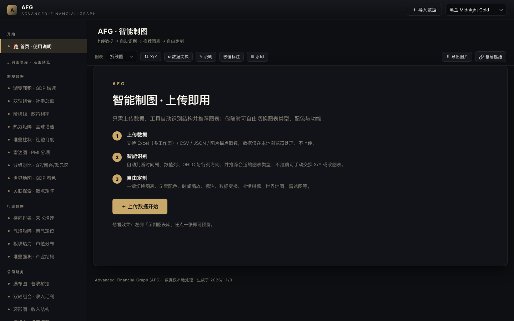 | 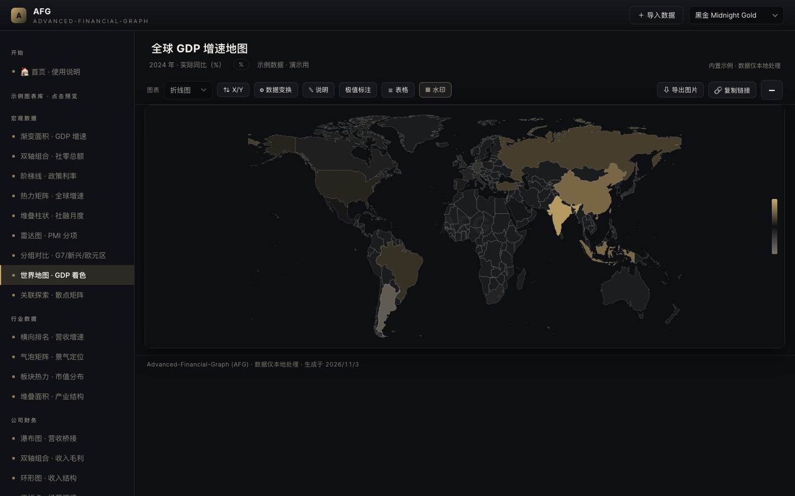 | 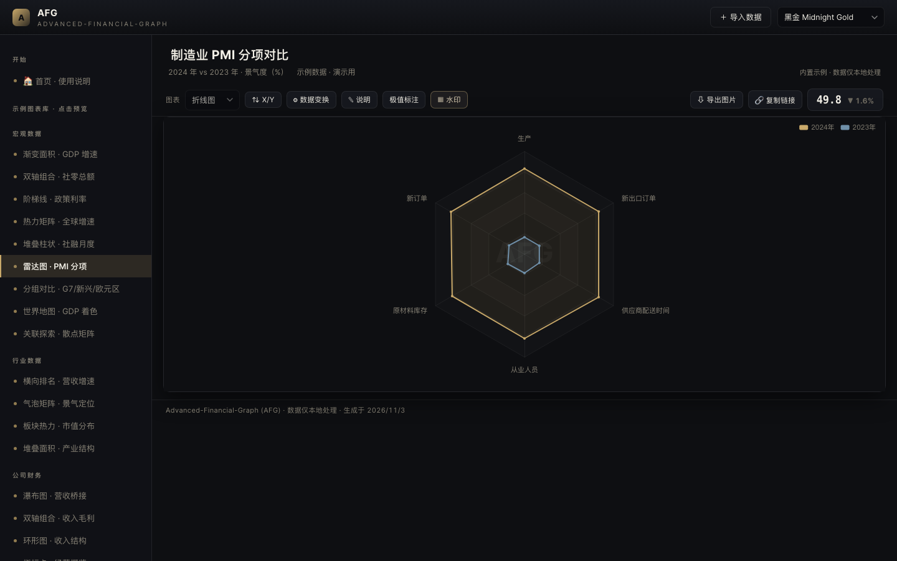 |
| 首页 / Home | 世界地图着色 / World map | 雷达图 / Radar |

| | | |
|:---:|:---:|:---:|
| 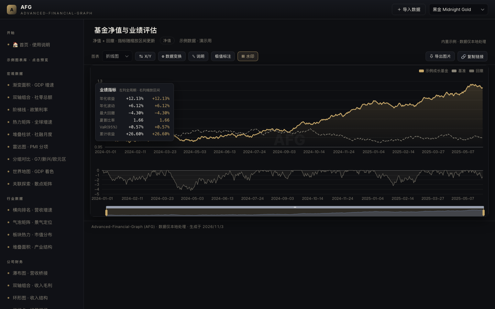 | 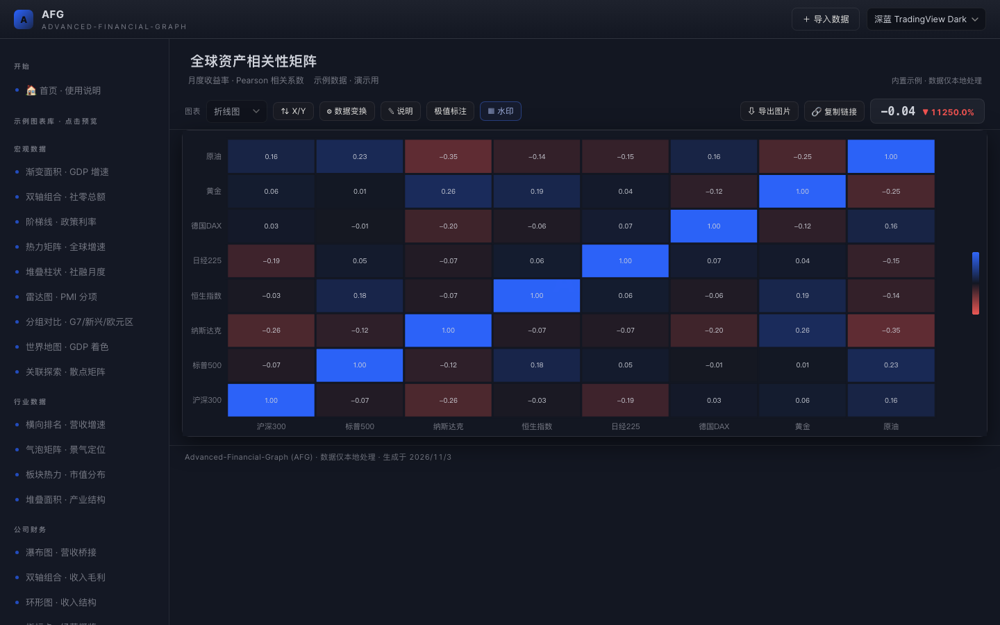 | 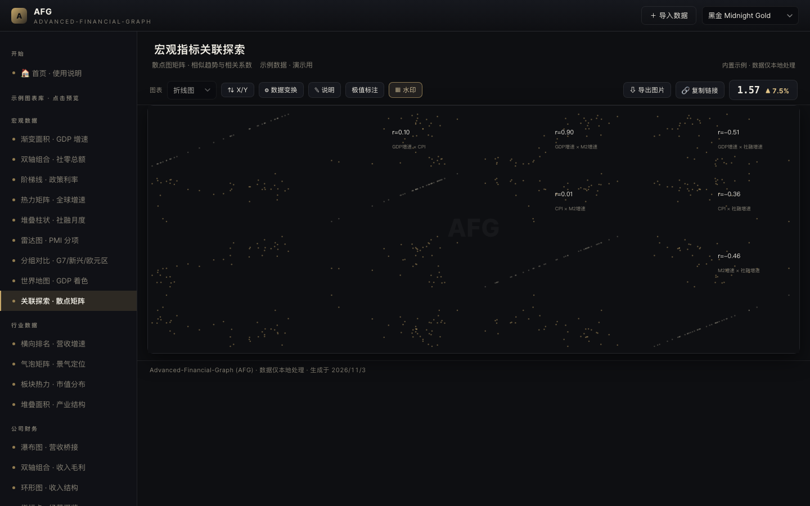 |
| 基金业绩评估 / Fund performance | 相关性矩阵 / Correlation | 关联散点矩阵 / Scatter matrix |

| | | |
|:---:|:---:|:---:|
| 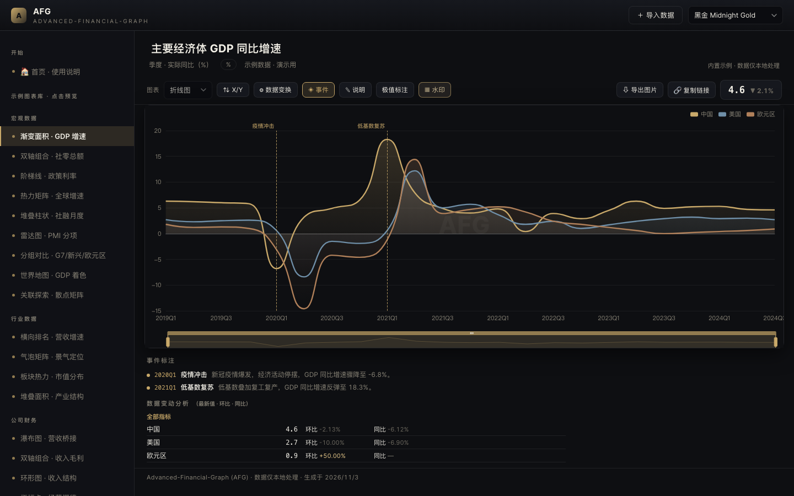 | 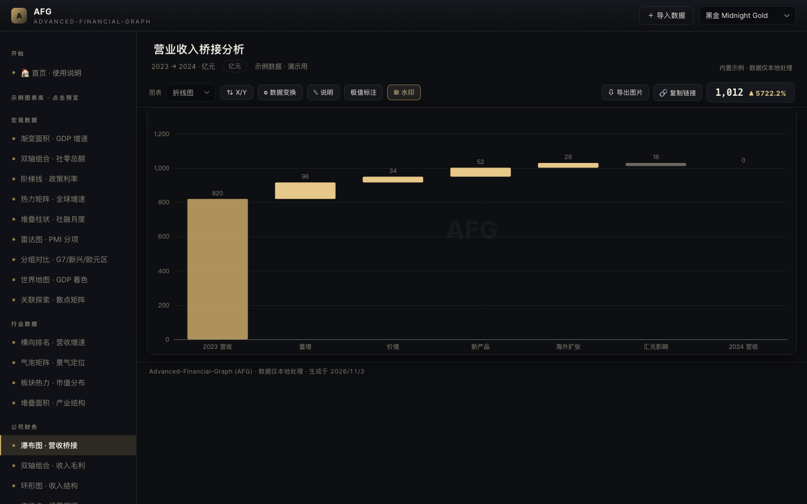 | 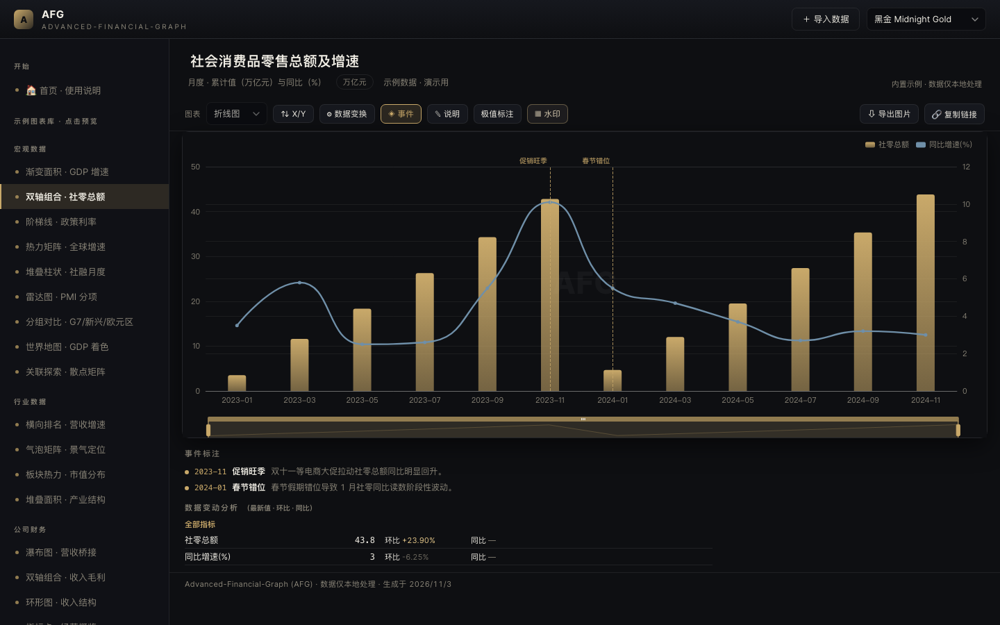 |
| GDP 面积图 · 事件标注 | 瀑布图 / Waterfall | 双轴组合 / Dual axis |

| | |
|:---:|:---:|
| 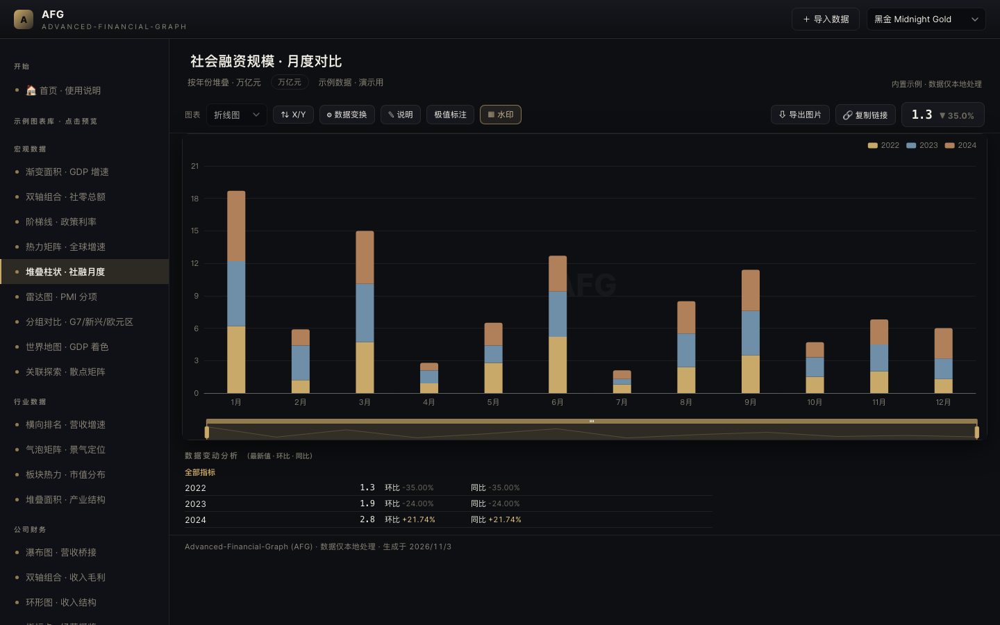 | 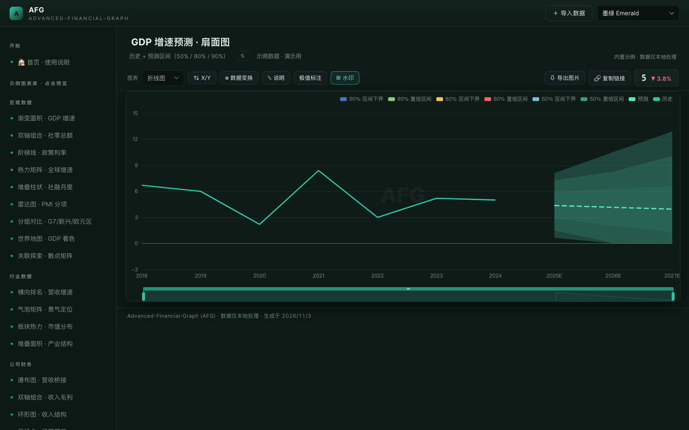 |
| 社融月度堆叠 / Stacked | 时间序列预测扇面 / Forecast fan |

---

## 功能 / Features

### 数据接入 / Data Input
- **Excel**（多工作表 / 单表多块，自动识别时间列、数值列、OHLC、行列方向）
- **CSV / JSON**（粘贴即解析，自动识别类型）
- **图片描点取数**（上传图表截图 → 标定坐标轴 → 点击取数据点）
- 所有数据**仅本地处理、不上传** / All data is processed locally, never uploaded.

### 图表类型 / Chart Types（20+）
折线 / 面积 / 柱状 / 堆叠 / 雷达 / K线 / 热力矩阵 / 瀑布 / 环形 / 散点矩阵 / 世界地图 / 指标卡 等。
Line / area / bar / stacked / radar / candlestick / heatmap / waterfall / donut / scatter matrix / world map / KPI cards, etc.

### 智能与专业 / Intelligence & Professionalism
- 自动推荐图表类型、自动判断 X/Y 轴方向（可一键交换）
- **极值标注**：标注可视区间内最高 / 最低 / 最新点，随缩放联动
- **事件标注**：图上竖线 + 图下详细说明（央行议息、政策发布等节点）
- **图上标注**：点击图表添加文字说明
- **分析板块**：各指标最新值 · 环比 · 同比，PMI 分项按「需求/生产/采购库存/就业/供应商」分组
- 悬停高亮当前系列、其余变暗；时间轴缩放；5 套配色；水印开关

### 机器学习 / Machine Learning
线性回归+置信带 · 时间序列预测扇面 · K-Means 聚类 · 相关性矩阵 · 收益分布 KDE

### 业绩评估 / Performance Analytics
年化收益 · 年化波动 · 最大回撤 · 阶段回撤 · 夏普比率 · VaR（随缩放区间更新）

### 宏观工具 / Macro Toolkit
变频（月→季 / 季→年）· 同比 / 环比 / 年内累计 · 指标运算（A 指标 ±×÷ B 指标）· 国家分组对比

---

## 快速开始 / Quick Start

### 本地使用 / Local
双击 `index.html` 即可，无需安装、无需联网。
Double-click `index.html` — no installation, no internet required.

### 在线使用 / Online
已部署版本：<https://saviorbill.github.io/afg/>

---

## 大模型接入 / LLM Integration

让大模型输出「图表配置 JSON」，粘贴到「导入数据 → 粘贴数据」即可出图；也可生成可分享链接（功能栏「🔗 复制链接」）。

Let an LLM output a "chart config JSON", paste it into "Import → Paste" to render; or generate a shareable link (toolbar "🔗 Copy link").

```json
{
  "type": "area",
  "title": "China GDP Growth YoY",
  "labels": ["2019", "2020", "2021", "2022", "2023"],
  "series": [{ "name": "GDP YoY", "values": [6.0, 2.2, 8.4, 3.0, 5.2] }]
}
```

给大模型的提示词 / Prompt template for the LLM：

> 请把下面的分析结论整理成 JSON 图表数据，格式：`{"type":"area","title":"...","labels":["..."],"series":[{"name":"...","values":[...]}]}`。type 可选 line/area/bar/stacked/radar。

---

## 部署 / Deploy

- **GitHub Pages**：推送到仓库根目录 → Settings → Pages → 选 `main` 分支 + `/ (root)` → Save。
- **Vercel / Netlify**：直接拖拽本文件夹上传即可。

---

## 目录结构 / Structure

```
index.html         入口 / Entry
css/style.css      设计系统 / Design system
js/                业务模块 / Modules（themes / data-loader / ml / chart-factory / price-chart / app）
vendor/            本地化依赖 / Local libs（ECharts / Lightweight Charts / SheetJS / world map）
fonts/             本地 Inter 字体 / Local Inter font
screenshots/       图表展示截图 / Screenshots
```

---

*AFG — Advanced-Financial-Graph · 高级金融图表，用于国际路演 / institutional roadshows.*
